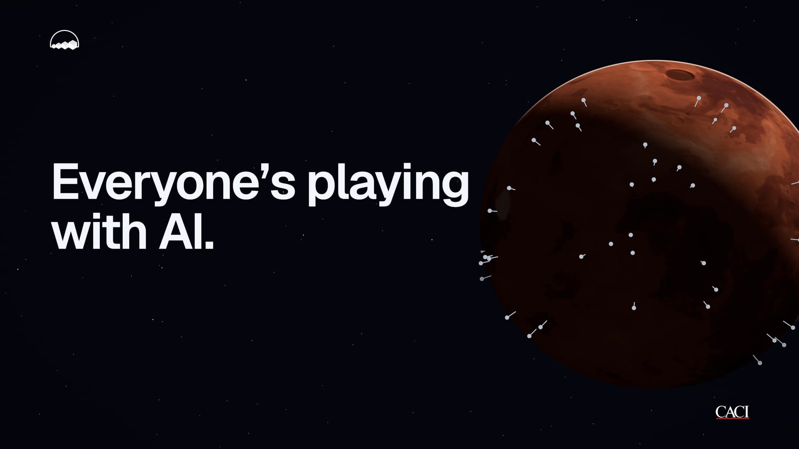
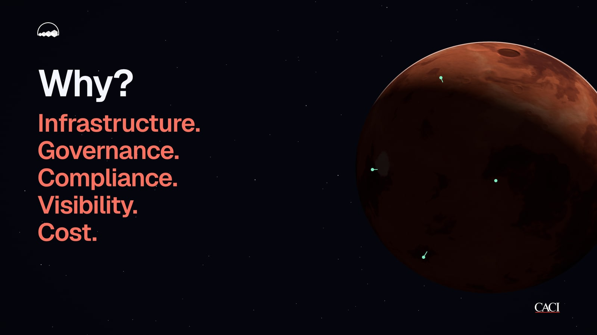
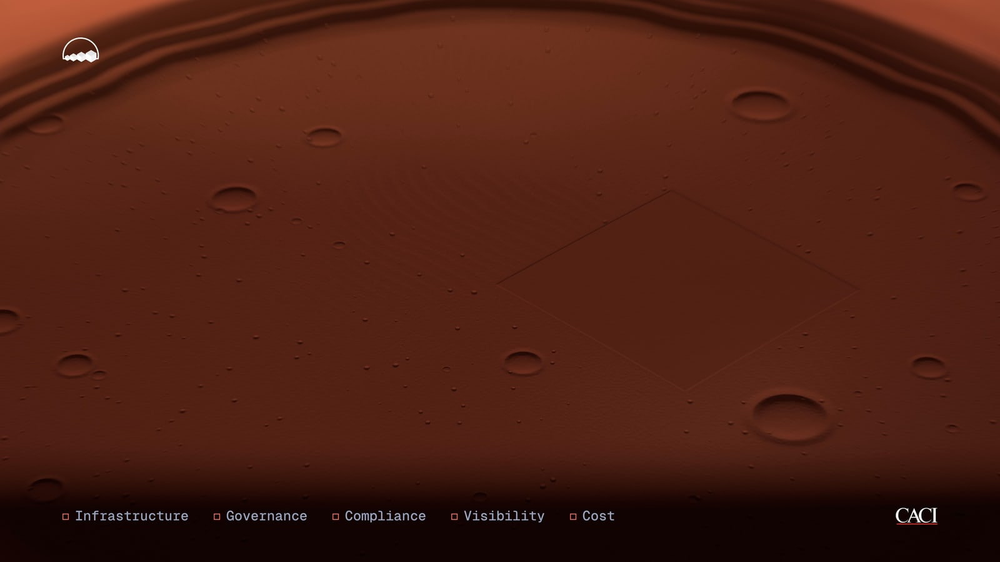
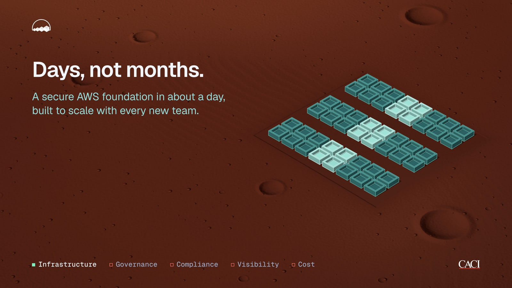
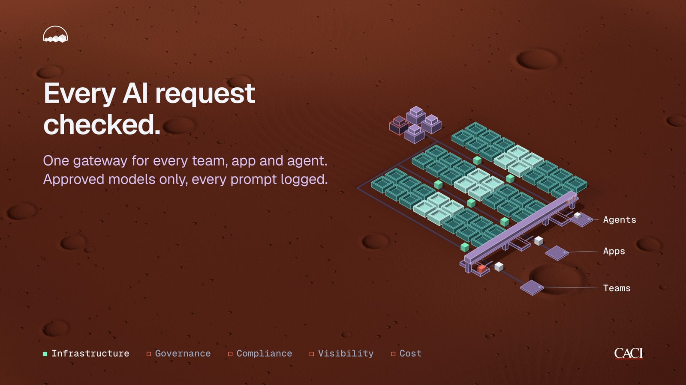
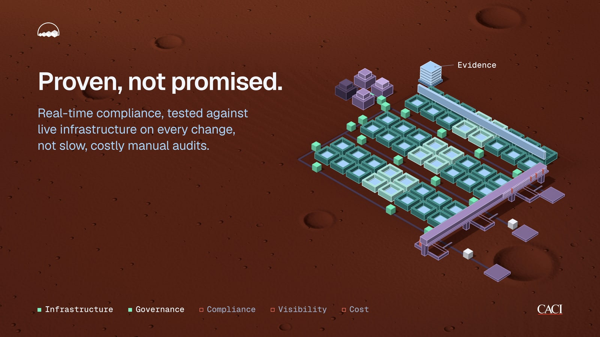
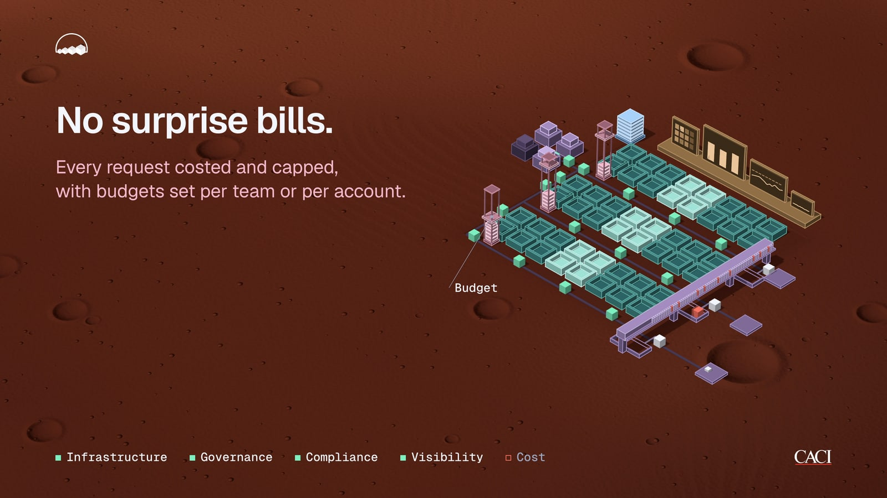
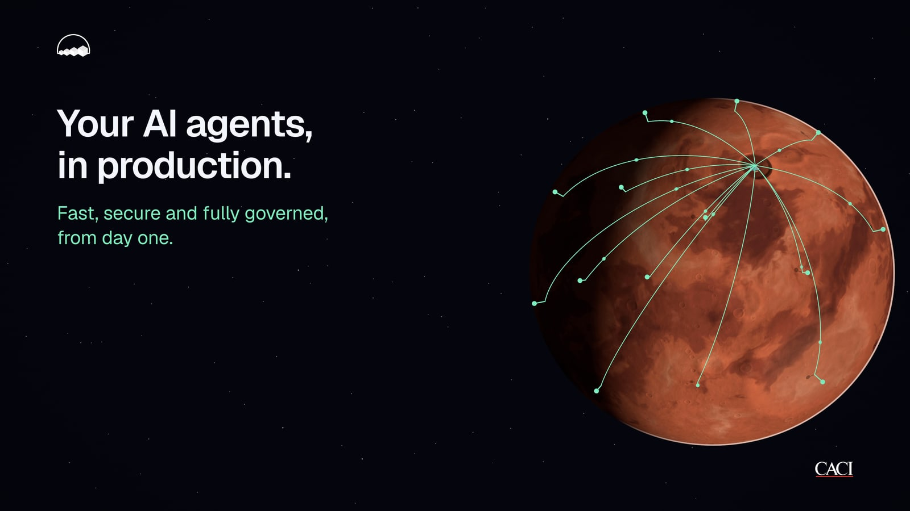
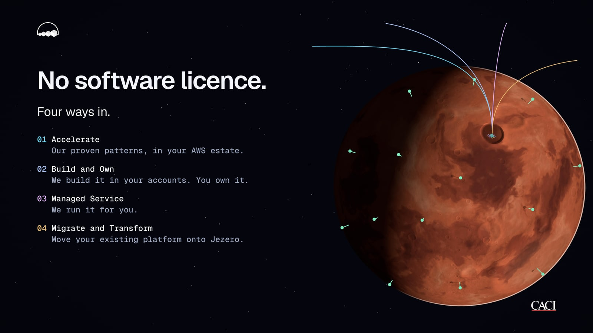
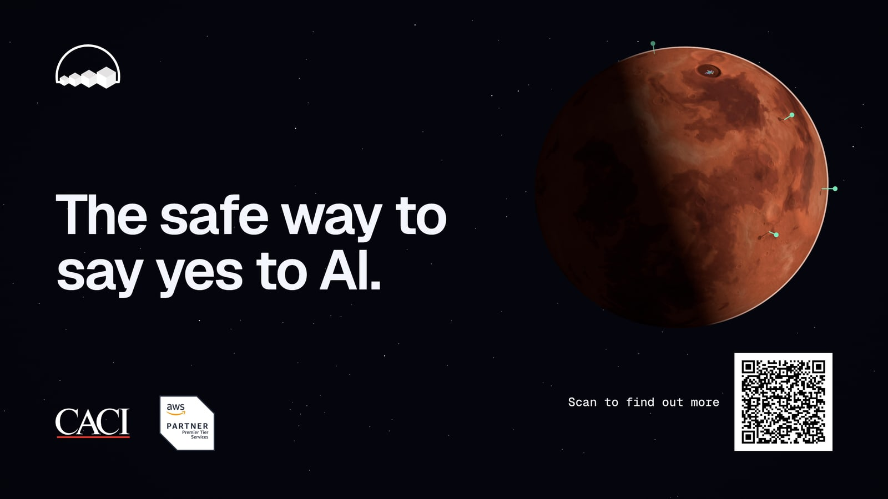

# Jezero AI launch film

An 80-second, silent, seamlessly looping 4K launch film for **Jezero AI** (IdentityE2E, a CACI business), made for screens at industry events and on exhibition stands.

There is no video editor, no stock footage and no AI video model anywhere in this film. Every frame is **drawn by code**: about 3,300 lines of JavaScript running in a web browser, written with Claude Code over a series of review rounds. A script then asks Chrome to render each of the 4,800 frames at 4K, blends them for motion blur, and encodes them into the final MP4.



## Why not just use a video model?

AI video models can produce some stunning footage. But a product launch film has requirements they can't reliably meet yet:

| | AI video model | This film (code-generated) |
|---|---|---|
| **Text** | Often garbled or misspelt, and drifts from frame to frame | Real typography (Geist), set to a type scale and grid; every word is exactly the approved copy |
| **Brand** | Logos get redrawn or distorted | The official logo files are embedded byte for byte, never redrawn |
| **Facts** | The model decides what appears | Every claim comes from an approved list in the brief |
| **Editing** | Change one thing, regenerate the whole clip and hope | Change one number (a colour, a timing, a camera angle) and only that changes |
| **Consistency** | Objects morph between shots | One world, one camera, one kit of parts for the whole film |
| **Length and looping** | Short clips, hard to loop | 80 seconds in one continuous camera move; the last frame flows into the first |
| **Resolution** | Usually upscaled | Rendered natively at 3840x2160, pixel-exact text and lines |
| **Reproducibility** | Each generation is different | Every frame is a pure function of time: render it twice and you get the same pixels |

The film is a program. "Make the planet a bit darker" or "hold this line half a second longer" are one-line edits, and the whole film re-renders the same way.

## The story

The film follows the brief's narrative: everyone is experimenting with AI, few make it to production, and the reasons are always the same five things. A five-word tracker (Infrastructure, Governance, Compliance, Visibility, Cost) runs along the bottom, and each word resolves as the film answers it.

| Time | Shot | What you see |
|---|---|---|
| 0 to 8s | Everyone's playing with AI / few make it | Mars from orbit. Silver pins (AI pilots) rise across the surface; most fail and sink away, five survive in mint |
| 8 to 14s | Why? | The film's single "scale slam", then the five reasons land one per beat and slide down into the tracker |
| 14 to 21s | Logo reveal and descent | The Jezero AI logo, then the camera dives into Jezero crater, dolly-zooming from the cinematic view into an isometric one |
| 20 to 53s | The five answers | A station is built on the crater floor, one section per answer, each in its own colour: a tray foundation, a governed AI gateway with live request traffic, a compliance scanner and evidence stack, live dashboards, and per-team budget meters |
| 53 to 71s | In production, four ways in | The camera climbs back to orbit; the station's plan stays drawn in the crater, mint arcs carry live traffic to agents across the planet, and four trajectories arrive for the four ways to engage |
| 71 to 80s | End card | Tagline, QR code, CACI and AWS Premier Tier Partner logos, then the camera drifts back to the opening view |

| | | |
|---|---|---|
|  |  |  |
|  |  |  |
|  |  |  |

## How it was made

### 1. A brief, not a prompt

It started with a detailed brief ([docs/jezero-ai-launch-film-brief-v2.md](docs/jezero-ai-launch-film-brief-v2.md)), written after reviewing a first version of the film. Its job is to fix what it is: the story, the approved claims, a design system (a 12-column grid, four layouts, four type styles, a colour palette), the visual direction and the rules. The v1 review fed straight into it: keep the planet, the isometric tiles and the continuous camera; remove every glow, blur and toy-like 3D object; and never place text anywhere except through the layout system.

### 2. A storyboard to approve before any code

The first deliverable was a storyboard ([docs/storyboard.html](docs/storyboard.html)), not code: every shot drawn with its layout, timing, on-screen text and camera move, plus the decisions that needed the client's call. Only once it was approved did the build start.

### 3. Built shot by shot, then reviewed in rounds

The film was built one shot at a time. Each shot was reviewed in the browser: the film has a debug mode with a scrub bar, and can loop a single shot. Shots 1 to 8 were approved one by one; the rest was finished end to end and then refined over twelve rounds of feedback. A few examples of what changed along the way:

- **Pacing.** Text was slowed down twice (lines now rise over 1.2s and hold for at least two seconds once readable), and the film grew from the brief's 60 seconds to 80 so nothing feels rushed on an event screen.
- **The crater.** Jezero went from a dark hole, to a rust bowl, to a darker terraced crater with a rim shadow, a delta, ejecta streaks and real ground detail (regolith grain, dunes, small craters, rocks) that appears as the camera descends.
- **The markers.** Ring-and-dot markers became flat discs ("look like pimples"), then 3D pins with sun-cast shadows, silver in the opening so they read apart from the white text.
- **The station.** Governance, Visibility and Cost were rebuilt as parts of one planned station, so the final pull-back reads as designed rather than bolted together, with each section in its own colour at matched lightness.
- **The end card.** It was rebuilt on the grid and refined three times: logo sizes, the QR code's position, the tagline's optical centring.

Every decision and piece of feedback is logged in [docs/PROGRESS.md](docs/PROGRESS.md), the handover file that let the work continue across sessions.

### 4. A layout check that runs on every build

Before every review, an automated check ([scripts/check-layout.mjs](scripts/check-layout.mjs)) plays the whole film in a headless browser, sampling every 0.1 seconds. It fails if any text overlaps other text or sits closer than 24px to it, leaves the safe area, crowds a 3D object, or has a contrast ratio below 4.5:1 against the rendered pixels behind it. That's how a film with dozens of moving labels stays tidy.

## How the film works

The whole film is one self-contained HTML file ([jezero-ai-launch-film.html](jezero-ai-launch-film.html), 1.4 MB, with the fonts, logos and libraries embedded, so it works offline). Open it in Chrome and it plays. Add `?debug` for the scrub bar, or `?shot=8` to loop one shot.

- **Time is the only input.** `seek(t)` draws the frame at time `t`, and the same `t` always gives the same picture. There are no timers, no CSS animations and no randomness at run time (random-looking things come from seeded generators). This is what makes a frame-perfect export possible.
- **The world** is one [three.js](https://threejs.org) scene with one camera for all 80 seconds.
  - **Mars** is ray-traced as an exact sphere in a shader, with its surface baked once from 3D noise.
  - **Jezero crater** is drawn analytically per pixel, so it stays sharp from orbit right down to the floor.
  - **The isometric kit** (trays, gateway, cubes, scanner, screens, meters) is built from a small set of parts with exact three-tone shading and crisp 1.5px edges.
  - **Every camera move** hands off from the previous one; the dive into the crater is a log-eased dolly-zoom from a 36 degree to a 7 degree field of view.
- **Text is never in the 3D world.** It's real HTML text over the scene, positioned only through the layout system, so it's always perfectly sharp.
- **Source.** The code is in `src/js/`, one file per shot plus shared modules for the engine, text, planet and kit. `node scripts/build.mjs` assembles it into the single HTML file.

## From code to MP4

[scripts/render.mjs](scripts/render.mjs) turns the HTML film into the final video: `jezero-ai-launch-film-4k.mp4`, 80 seconds, 3840x2160, 60fps, H.264, 240 MB.

1. **Render every frame at 4K.** The script opens the film in Chrome with a real device scale factor of 2: the page is laid out at 1920x1080, but text, logos and the 3D scene are all drawn at 3840x2160. Nothing is upscaled.
2. **Motion blur from subframes.** Each of the 4,800 frames is the average of **8 renders** spread across the time a real camera's shutter would be open (a 180 degree shutter, 1/120 of a second). The renders are averaged in linear light, as light would add up on a camera sensor. Anything moving gets natural motion blur. Anything still is identical in all 8 renders, so it comes out byte for byte as the browser drew it, not a pixel softer. That's 38,400 renders in all.
3. **Every capture is checked.** Each render is screenshotted twice and only kept when both agree, because Chrome can occasionally return a screenshot before new text has been painted.
4. **Stitch and encode.** The blended frames are written as lossless PNGs (resumable if anything interrupts), then encoded with ffmpeg and x264: `-preset veryslow -crf 10`, yuv420p, BT.709 colour. CRF 10 measured within about half a decibel of a lossless encode, and faint stars keep 99% of their brightness.

The full render took about 2 hours 20 minutes on an Apple M3 MacBook (three Chrome instances in parallel), plus 23 minutes to encode.

### Verified against the browser

At 3, 31, 38, 50, 69 and 75 seconds the MP4 frames were compared with the browser rendering the same moment directly:

- **Before encoding:** 99.6 to 99.9% of every frame was byte-identical. The only differences were on moving objects (the drifting planet, request cubes, the scanner), which carry their motion blur.
- **After encoding:** text sharpness measured 0.999 to 1.003 of the browser's (1.0 = identical), and 99.1 to 99.5% of each star's brightness survived.
- **The loop:** the camera's motion is continuous across the join between the last frame and the first, so the film loops without a visible seam.

### Two Chrome details found along the way

1. **Played-through text came out slightly soft.** The text lines carry a `will-change: transform` hint for smooth live playback. With it, Chrome keeps a line's image from mid-animation and resamples it once the line has settled, so text that had animated in was a touch softer than a fresh render of the same moment. The export switches the hint off, and every frame's text then matches a direct render.
2. **Screenshots can land early.** The first screenshot after the page loads can be taken before new text is painted, which is why every capture is taken twice and compared.

## Running it yourself

```bash
npm install                                  # three.js, Geist, Playwright, sharp, ffmpeg-static
node scripts/build.mjs                       # src/ -> jezero-ai-launch-film.html
open jezero-ai-launch-film.html              # play it (add ?debug for the scrub bar)
node scripts/check-layout.mjs                # the automated layout check
node scripts/render.mjs                      # the 4K MP4 (about 2.5 hours; resumable)
node scripts/render.mjs --from 19 --to 21 --out test.mp4   # a short test render
```

Playwright uses your installed Google Chrome (`channel: 'chrome'`). The MP4 itself isn't in this repository: at 240 MB it is over GitHub's file size limit.

## Folders

| Folder | What's in it |
|---|---|
| `src/` | The film: `js/` (one module per shot, plus the engine, text, planet and kit), `shell.html`, `style.css` |
| `assets/` | The logo files the film embeds |
| `scripts/` | `build.mjs`, `check-layout.mjs`, `render.mjs` |
| `docs/` | The brief, the approved storyboard, the progress log, and the stills used in this README |
| `brand/` | The brand files as originally supplied |

---

Made with [Claude Code](https://claude.com/claude-code).
